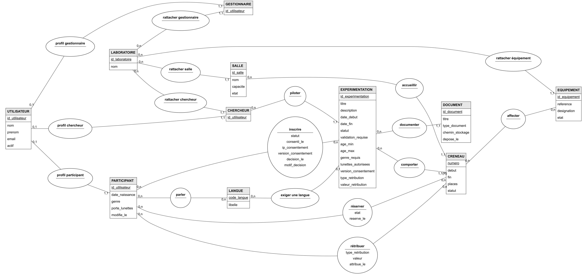

# XPLab

**Concevoir une plateforme pour organiser les expérimentations d'un laboratoire de recherche.**

  

XPLab rassemble le suivi des études, les candidatures des participants, les réservations de créneaux et la gestion des salles et équipements. L'objectif est de relier ces informations dans un même système, avec des actions adaptées à chaque rôle.

Ce dépôt présente le travail réalisé de l'analyse des besoins jusqu'à la base de données : **cahier des charges, modélisation et deux implémentations SQL**. Le développement de l'application web constitue la prochaine étape.

[Étude de cas sur mon portfolio](https://dastan.fr/fr/projets/xplab/) · [Documents du projet](docs/README.md) · [Exécuter les scripts](docs/execution.md)

## 🎯 Le besoin

Une expérimentation mobilise plusieurs personnes et ressources. XPLab doit permettre de suivre le parcours complet :

1. Le chercheur définit l'étude et ses critères de participation.
2. Le gestionnaire organise les créneaux, les salles et le matériel.
3. Le participant consulte les études compatibles avec son profil et réserve après consentement.
4. Le chercheur examine les candidatures lorsque la validation est nécessaire.
5. Après la séance, il enregistre la présence et l'éventuelle rétribution.

Le cahier des charges prévoit six profils. La base publiée se concentre sur **le chercheur, le gestionnaire et le participant** ; les fonctions de direction, de supervision et d'administration sont décrites dans les spécifications.

## 👤 Ma contribution

J'ai assuré l'essentiel de l'analyse des besoins et de la rédaction du cahier des charges, ainsi que la conception et la réalisation de la base de données. Mon travail couvre les scénarios d'utilisation, les spécifications fonctionnelles, l'architecture, les parcours de navigation, les règles de gestion, la modélisation et les scripts SQL Server et MySQL.

Le projet est réalisé en équipe de trois, avec **120 heures prévues par étudiant**, dans le cadre de ma deuxième année de BUT Informatique. La planification et les maquettes Figma ont été réalisées par les autres membres de l'équipe.

## 🛠️ Technologies et outils

| Élément | Utilisation dans le projet |
| --- | --- |
| SQL Server / T-SQL | Première implémentation de la base, contraintes, vues et procédures stockées |
| MySQL / MariaDB | Adaptation du même modèle à un second dialecte SQL ; essais de cette version sur MariaDB 10.4.32 |
| SQL Server Management Studio | Exécution et consultation de la version SQL Server |
| MCD, MLD et dépendances fonctionnelles | Construction du modèle et vérification des relations entre les données |
| diagrams.net (draw.io) | Réalisation de schémas de conception |
| Figma | Maquettes et prototype d'interface du projet collectif |

L'architecture web prévue s'appuie sur une pile LAMP et PHP avec PDO. Elle est décrite dans le cahier des charges ; le code applicatif n'est pas encore présent dans ce dépôt.

## 🗃️ Conception de la base

**11 entités dans le MCD, 16 tables dans chaque version SQL.**

<a href="docs/images/xplab-mcd.webp"></a>

[Agrandir le MCD](docs/images/xplab-mcd.webp) · [Voir le MLD](docs/images/xplab-mld.webp) · [Comprendre les choix de conception](docs/base-de-donnees.md)

Quelques décisions structurantes :

- **Une identité, plusieurs rôles** : un utilisateur peut cumuler les rôles de chercheur, gestionnaire et participant.
- **Une candidature distincte des réservations** : l'inscription concerne une étude ; les réservations concernent ses créneaux.
- **Des relations cohérentes** : les clés étrangères composées empêchent de réserver un créneau d'une autre étude que celle de l'inscription.
- **Un historique conservé** : les annulations changent l'état des lignes, sans effacer les participations passées.
- **Des opérations atomiques** : une procédure annule ses modifications si un contrôle échoue.

Chaque version comprend **9 consultations et 9 procédures stockées**, réparties entre les trois rôles. Trois consultations s'appuient sur des vues. Les versions SQL Server et MySQL proposent le même périmètre fonctionnel.

## 🔎 Un cas concret : éviter les conflits de réservation

Un participant a déjà réservé de **10 h à 11 h**. Un créneau de **9 h 30 à 11 h 30** doit aussi être exclu, même si son heure de début précède la réservation existante.

La consultation PA01 compare les deux bornes :

```sql
c_reserve.debut < c.fin
AND c.debut < c_reserve.fin
```

Cette condition couvre les chevauchements partiels et les inclusions complètes. Elle autorise aussi deux séances consécutives, par exemple de 10 h à 11 h puis de 11 h à 12 h.

## 📚 Documentation

| Document | Ce qu'il permet d'explorer |
| --- | --- |
| [Cahier des charges complet (PDF, 127 pages)](docs/rapports/cahier-des-charges.pdf) | Besoin, spécifications, architecture, parcours, maquettes et planification |
| [Dossier de conception BDD (PDF, 17 pages)](docs/rapports/conception-bdd.pdf) | Règles de gestion, dictionnaire, dépendances fonctionnelles, MCD, MLD et commandes |
| [Synthèse du cahier des charges](docs/cahier-des-charges.md) | Vue d'ensemble du besoin et du périmètre |
| [Choix de conception de la base](docs/base-de-donnees.md) | Relations, contrôles métier, transactions et cas de réservation |
| [Guide d'exécution](docs/execution.md) | Environnements, ordre de lancement et premières consultations |

Le [guide de lecture](docs/README.md) donne les pages utiles pour accéder directement aux schémas, aux maquettes et aux parties techniques.

## 🚀 Explorer les scripts

Choisir **une** version, puis exécuter ses trois fichiers dans l'ordre :

| Étape | SQL Server | MySQL / MariaDB |
| --- | --- | --- |
| 1. Créer la base et les tables | [01-creation.sql](sql/sqlserver/01-creation.sql) | [01-creation.sql](sql/mysql/01-creation.sql) |
| 2. Charger les données de démonstration | [02-donnees.sql](sql/sqlserver/02-donnees.sql) | [02-donnees.sql](sql/mysql/02-donnees.sql) |
| 3. Créer les vues et procédures, consulter les données | [03-exploitation.sql](sql/sqlserver/03-exploitation.sql) | [03-exploitation.sql](sql/mysql/03-exploitation.sql) |

**Le script de création supprime puis recrée la base `XPLab_SAE3`.** Utiliser une instance de développement sans données à conserver sous ce nom. Les exemples utilisent des données fictives et des dates fixes en 2026 : voir le [guide d'exécution](docs/execution.md) pour les essais ultérieurs.

## 📍 État du projet

| Étape | État |
| --- | --- |
| Analyse des besoins et cahier des charges | Réalisée |
| Modélisation et scripts SQL Server / MySQL | Réalisés |
| Application web et intégration | À développer |
| Validation des parcours complets | À venir |

Les contrôles métier passent par les procédures prévues. La gestion des demandes simultanées reste une limite à traiter lors de l'intégration : une transaction seule ne garantit pas l'absence de conflit entre plusieurs réservations concurrentes.

Le projet m'a permis de travailler la traduction d'un besoin en règles de gestion, la modélisation relationnelle et l'adaptation d'opérations métier à deux moteurs SQL.

Berat DASTAN
