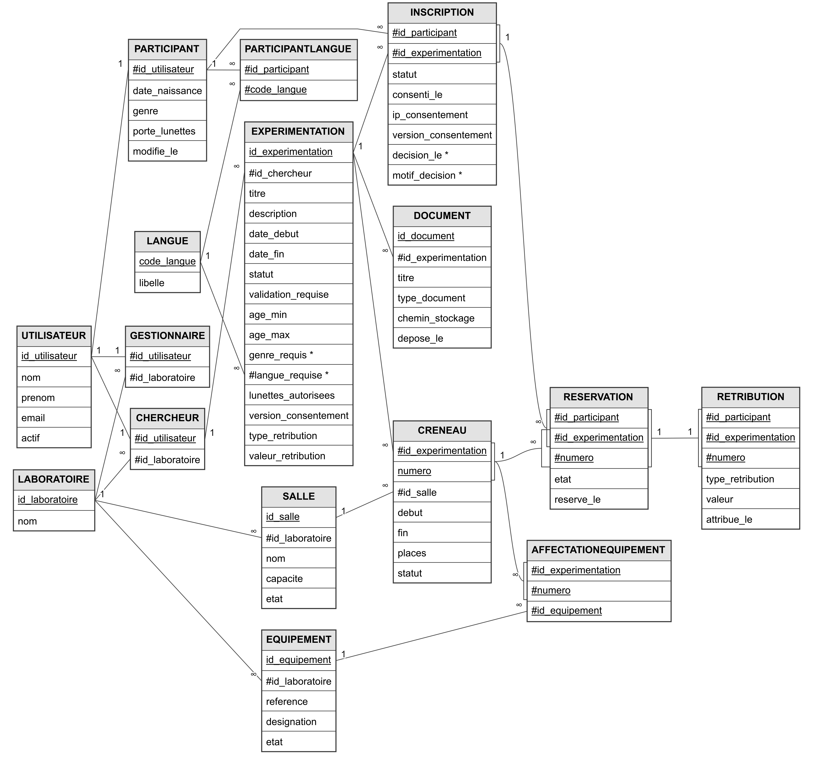

# XPLab - choix de conception de la base

## Du besoin au modèle

Le travail part des règles de gestion et du dictionnaire des données. Les dépendances fonctionnelles aident à déterminer les identifiants et les regroupements d'attributs avant la construction du modèle conceptuel (MCD), puis du modèle logique (MLD).

Le MCD comporte **11 entités**. Le passage au modèle relationnel produit **16 tables** : les entités, complétées par les associations `ParticipantLangue`, `AffectationEquipement`, `Inscription`, `Reservation` et `Retribution`.

[Voir le MCD en grand](images/xplab-mcd.webp) · [Voir le MLD en grand](images/xplab-mld.webp)



## Des décisions qui portent des règles métier

### Une identité commune, plusieurs rôles

`Utilisateur` porte l'identité et l'adresse électronique unique. `Chercheur`, `Gestionnaire` et `Participant` reprennent cet identifiant comme clé primaire et clé étrangère. Une même personne peut ainsi cumuler des rôles sans multiplier son identité.

### Candidater n'est pas réserver

`Inscription` relie le participant à une expérimentation et conserve l'état de sa candidature ainsi que les informations du consentement. `Reservation` relie cette inscription à un créneau précis. La décision concernant une étude ne se confond donc pas avec l'état d'une séance : réservée, annulée, présente ou absente.

### Garder la même étude dans les relations

Le créneau est identifié par `(id_experimentation, numero)`. `Reservation` possède une clé étrangère composée vers l'inscription et une autre vers le créneau. Leur identifiant d'expérimentation commun interdit d'associer une inscription à une séance appartenant à une autre étude.

### Limiter la rétribution à une réservation

`Retribution` reprend la clé de `Reservation`. L'unicité limite chaque réservation à une rétribution. Les conditions de présence et d'autorisation sont traitées dans la procédure de validation ; la seule clé ne suffit pas à prouver qu'une personne était présente.

## Tables et responsabilités

| Ensemble | Tables |
| --- | --- |
| Identités et rattachements | `Laboratoire`, `Utilisateur`, `Chercheur`, `Gestionnaire`, `Participant` |
| Profil linguistique | `Langue`, `ParticipantLangue` |
| Études et ressources | `Experimentation`, `Salle`, `Equipement`, `Creneau`, `AffectationEquipement`, `Document` |
| Participation et suivi | `Inscription`, `Reservation`, `Retribution` |

## 18 commandes pour trois rôles

Chaque rôle dispose de trois consultations et de trois procédures stockées.

| Rôle | Consultations | Procédures |
| --- | --- | --- |
| Chercheur | Études et candidatures ; candidatures et créneaux ; bilan des présences et rétributions | `ec_creer_experimentation`, `ec_decider_inscription`, `ec_valider_presence` |
| Gestionnaire | Salles ; planning ; affectations d'équipements | `gl_creer_creneau`, `gl_affecter_equipement`, `gl_modifier_salle` |
| Participant | Créneaux accessibles ; historique et rétributions ; documents de ses études | `pa_modifier_profil`, `pa_reserver_creneau`, `pa_annuler_reservation` |

Trois consultations utilisent des vues :

- `vue_etudes_candidatures` : compter les candidatures par étude, y compris lorsqu'une étude n'en a pas encore.
- `vue_bilan_experimentations` : regrouper les informations de présence et de rétribution par étude.
- `vue_planning_salles` : présenter les créneaux des salles dans le périmètre du laboratoire.

## Les contrôles sont répartis entre contraintes et procédures

Les clés primaires évitent les doublons ; les clés étrangères encadrent les relations. Les contraintes `NOT NULL`, `UNIQUE`, `DEFAULT` et `CHECK` définissent les valeurs attendues.

Les procédures portent les contrôles qui dépendent de plusieurs tables : rôle de l'acteur, compatibilité du profil, places restantes, disponibilité d'une salle ou d'un équipement, état de la candidature et validité de la réservation. Elles exécutent les modifications dans une transaction et annulent l'opération en cas d'erreur.

**Limite :** le livrable ne traite pas complètement les demandes simultanées. Une transaction, à elle seule, ne prouve pas l'absence de conflit entre deux utilisateurs concurrents. L'application devra également utiliser les procédures prévues, plutôt que contourner ces contrôles par des écritures directes.

## Cas concret : le chevauchement des créneaux

La consultation PA01 écarte un créneau si une réservation active du participant recouvre ce créneau :

```sql
c_reserve.debut < c.fin
AND c.debut < c_reserve.fin
```

Pour une réservation existante de 10 h à 11 h :

| Créneau candidat | Conclusion sur le chevauchement |
| --- | --- |
| 10 h 30 - 11 h 30 | Conflit partiel |
| 9 h 30 - 11 h 30 | Conflit : la réservation est entièrement englobée |
| 11 h - 12 h | Aucun chevauchement ; les autres règles restent à vérifier |

Cette formulation couvre les inclusions complètes que la seule comparaison des heures de début manquerait. Les opérateurs stricts autorisent deux créneaux contigus.

## Deux dialectes, un même modèle métier

L'adaptation vers MySQL porte notamment sur les identifiants générés, les calculs de date, la syntaxe des procédures et la remontée des erreurs. Le modèle relationnel et le sens des opérations restent communs aux deux versions.

Les données de démonstration sont fictives. Les scripts sont conservés dans l'état du livrable scolaire ; le [guide d'exécution](execution.md) précise l'ordre de lancement et l'effet des dates fixes.
